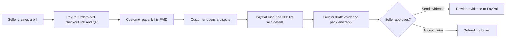

# ProofPay: AI Dispute Defender for small sellers

Built for the **Build What's Next with PayPal and AI** hackathon.

**Demo video:** (add the YouTube link here after upload)

Small sellers lose money when a customer opens a PayPal "item not received" dispute. The proof is scattered across bills and chats, and writing a good reply takes time they do not have. ProofPay reads the dispute from PayPal, drafts an evidence pack and a buyer reply with AI, and sends it to PayPal only after the seller approves.

## Features

1. **Bills with PayPal checkout.** The seller creates a bill and gets a PayPal pay link and QR code. After the customer approves the payment, the server captures it and marks the bill PAID.
2. **Dispute inbox.** Disputes are read live from the PayPal Disputes API. The buttons shown depend on the actions PayPal currently allows for that dispute.
3. **AI evidence pack.** Gemini reads the dispute, the matching bill and the seller's delivery proof, then returns a recommendation (FIGHT, ACCEPT or NEED_MORE_PROOF), evidence points, missing proof, and a polite buyer reply in English and Tamil.
4. **Owner approval.** The seller reviews and edits the notes, then sends the evidence to PayPal or accepts the claim (which refunds the buyer).

## How it works



## Tools used and how

| Tool | How it is used |
|---|---|
| **PayPal Orders v2 API** | Create a checkout order for each bill, capture the payment after approval |
| **PayPal Customer Disputes v1 API** | List disputes, show dispute details, provide evidence (PROOF_OF_FULFILLMENT with courier tracking), accept claim |
| **Google Gemini API** | Reads the dispute, bill and seller notes and returns a structured JSON evidence pack plus a bilingual buyer reply |
| Node.js, Express, qrcode, dotenv | Server, QR codes, environment variables |

PayPal is central: without PayPal there are no bills, payments or disputes. AI is central: the evidence pack, the fight or accept recommendation and the buyer reply come from Gemini.

## Responsible AI design

- The AI only uses facts from the bill, the dispute and the seller's notes. It must not invent tracking numbers, dates or delivery claims.
- A rule in code, not only in the prompt, blocks a FIGHT recommendation when there is no tracking number.
- The buyer's note is treated as data, never as instructions.
- Nothing is sent to PayPal until the seller clicks approve. Accepting a claim asks for confirmation because it refunds the buyer.
- Gemini calls retry on overload and fall back to a second model.

## Setup

Requirements: Node.js 18 or newer, a free PayPal developer account, a Gemini API key.

1. Clone and install:
   ```
   git clone https://github.com/kit25cseasherlins-dotcom/proofpay.git
   cd proofpay
   npm install
   ```
2. At developer.paypal.com, open Testing Tools > Sandbox Accounts and create two **United States** accounts: one Business (seller) and one Personal (buyer). Sandbox accounts from other countries can fail with currency errors.
3. Under Apps & Credentials > Sandbox, create a Merchant app, enable **Disputes** in its features, and copy the Client ID and Secret.
4. Get a Gemini API key from Google AI Studio.
5. Copy `.env.example` to `.env` and fill in the values. Set `GEMINI_MODEL` to a current Flash model your key can use, and `GEMINI_FALLBACK_MODEL` to another one. Model names change over time.
6. Start the server:
   ```
   node server.js
   ```
   Open http://localhost:3000

## Test steps for judges

1. On the home page, create a bill (for example Ravi, 20.00, Tea and biscuits).
2. Open the pay link in a private window and pay with the sandbox buyer account using the PayPal balance. You are sent back to the app and the bill shows PAID.
3. Log in to sandbox.paypal.com as the buyer, open Activity, pick the payment, choose **Report a problem**, then **Item not received**, and submit.
4. Wait a few minutes, open http://localhost:3000/disputes.html and press Refresh. The dispute appears with the matched bill.
5. Press **Draft with AI** with no tracking number to see the NEED MORE PROOF result. Then enter courier FEDEX and any test tracking number, add a delivery note, and draft again to see FIGHT.
6. Review the notes and press **Approve: send evidence to PayPal**. Refresh to see the dispute move to waiting for the buyer.

A dispute is matched to a bill by transaction ID, or by amount if the ID does not match. The app shows how it was matched.

## Limitations

- Sandbox only, USD only, no real money.
- Single-seller prototype with no login.
- Payment confirmation uses the PayPal return redirect, not webhooks.
- Delivery evidence supports FedEx, UPS and USPS tracking only.
- Local JSON files instead of a database.
- The AI can be wrong or unavailable, which is why the seller always approves.

## Security notes

- Secrets live in `.env`, which is git-ignored. Only `.env.example` with empty values is committed.
- Dispute IDs, tracking numbers and notes are validated on the server.
- The page renders data with `textContent`, not raw HTML.

## Future work

Webhooks for live dispute updates, supplier payouts, subscription billing for regular customers, seller login and a database, and more languages.

## Project structure

- `server.js`: Express server, bills, PayPal checkout, dispute routes
- `paypal-disputes.js`: PayPal Disputes API helpers
- `evidence-pack.js`: AI evidence pack and guardrails
- `gemini.js`: Gemini client with retry and fallback
- `public/index.html`: bills page
- `public/disputes.html`: dispute inbox
- Other root `.js` files are small scripts used during development to test the PayPal and Gemini APIs

## License

MIT, see the `LICENSE` file.